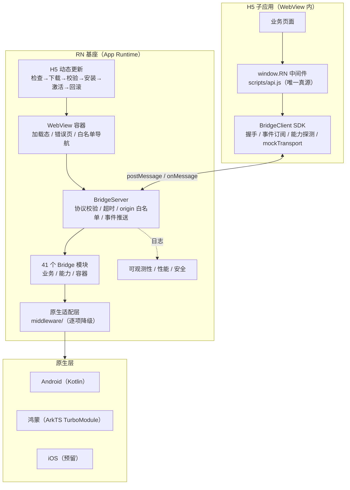
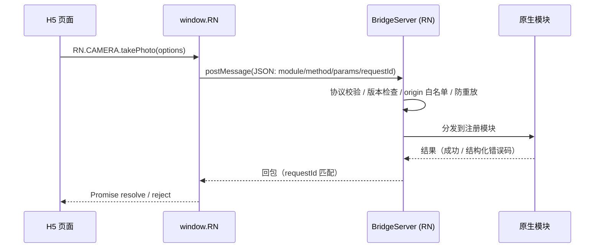
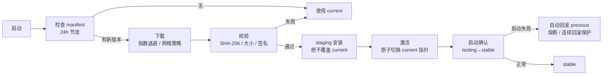

# RNbase — RN + H5 混合架构基座

React Native + WebView + H5 混合架构。RN 作为稳定的 App Runtime / Native Container，WebView 承载 H5 子应用，Native Bridge 是两者之间唯一受控的能力边界。本基座不承载业务功能，只提供容器、通信协议与设备能力，业务全部在 H5 子应用中实现。

## 1. 项目介绍

一个基座 + 多个 H5 子应用的混合开发方案，解决的核心问题是：**用 Web 技术栈做业务迭代，用原生壳提供设备能力与发版能力，两者通过受控协议通信**。

| 概念 | 说明 |
|---|---|
| 基座（本仓库） | RN 壳，提供 WebView 容器、Bridge 服务端、原生能力、H5 包管理与更新、可观测性 |
| H5 子应用 | 独立仓库（如 [RN_h5](https://github.com/GHchenjingqi/RN_h5)），Vue/React 均可，构建产物同步进基座 `h5/` 随包发布 |
| Bridge | H5 ↔ RN 唯一通道。H5 侧只通过 `window.RN` 中间件调原生，能力清单唯一真源是 `scripts/api.js` |
| 动态更新 | H5 子包独立于 APK 发版，支持远程检查、下载校验、原子切换、失败自动回滚 |

两仓配合的约束：

- H5 侧**只能**通过 `window.RN` 调原生，禁止直接接触 `window.ReactNativeWebView`；
  子应用的 `js/api.js` 由基座 `scripts/api.js` 同步而来，**md5 必须一致**（`npm run sync:api`）。
- 本地开发请把两仓放在同级目录，基座名 `app_base`、子应用名 `app_h5`；
  子应用侧脚本按同级 `app_base` 定位基座，目录名不同时用 `BASE_DIR` 指定。
- 应用名 / 包名 / 图标 / 闪屏 / 版本全部由子应用持有，基座不内置任何具体 App 值（见第 4 节）。

## 2. 架构与流程

### 2.1 总体架构



### 2.2 一次能力调用的完整链路



- H5 → RN 请求超时 30s；耗时操作（如下载）拆成「起任务 + 轮询」两条请求。
- 硬件返回键不直接退出：有 Bridge 时原生推 `native.back` 事件给 H5 决策，H5 用
  `app.nativeBackResult({ consumed })` 回执，400ms 超时由容器兜底。
  兜底**不靠 JS 侧导航快照**判断能否回退（react-native-webview v14 的 ref 已无 `canGoBack`，
  SPA `pushState` / hash 路由 / 错误页重载下快照会过期），而是按键那一刻读原生真值
  `WebView.canGoBack()`；退无可退也**不直接退出**，只提示「再按一次退出应用」（详见 4.3）。
- 软键盘显隐推 `keyboard.change` 事件，edge-to-edge 下避让交给 H5。

### 2.3 H5 子包动态更新链路



> 整包 APK 升级是另一条独立链路（`update` Bridge 模块 + 原生 `BaseUpdateModule.kt`），
> 仅 Android，走 `startDownload` 起任务 + `getProgress` 轮询 + FileProvider 拉起安装器，
> 校验链：尺寸核对 → zip 魔数 → SHA-256。两者互不混用。

## 3. 功能与多平台

### 3.1 Bridge 能力模块（41 个，`src/bridge/index.ts` 注册）

| 分类 | 模块 |
|---|---|
| 业务 | `app`（生命周期/返回键回执）· `auth` · `permission`（check/request/requestAll 批量）· `system`（vibrate/copy/share/darkmode/language/screen/accessibility/deviceInfo/battery）· `notification`（getToken/setBadge/playSound/sendNotification）· `log` |
| 设备能力 | `camera` · `scanner`（ML Kit）· `media` · `file` · `location` · `clipboard` · `brightness` · `flashlight` · `sensor` · `biometric` · `contacts` · `calendar` · `nfc` · `bluetooth` · `audio` · `storage` · `network-info` · `qr` · `image` · `haptics` · `speech` · `appManager`（检测安装/拉起外部 App/应用市场/系统设置）· `background-task` · `in-app-review` |
| 容器 | `toast` · `dialog` · `orientation` · `statusBar` · `keyboard` · `navigation` · `webView` · `device` · `battery` |
| 其他 | `network`（网络状态）· `update`（整包 APK 远程升级，仅 Android） |

能力模块通过 adapters 注入原生实现，**某平台未接入时逐项降级**，H5 侧收到 `DEVICE_UNSUPPORTED` 据此隐藏入口。全部方法的参数、返回值、错误码见 `DEVICE_CAPABILITIES.md` 与 `docs/BRIDGE_API.generated.md`。

### 3.2 WebView 容器

- `WebViewController` 状态机（idle / loading / loaded / error），结构化错误分类，加载中 / 错误页组件。
- 域名白名单导航：白名单内走 WebView，域外跳转交给系统浏览器。
- 沉浸式安全区：本地模式注入 `window.RN_SAFE_AREA` 由 H5 自行留白；远程模式注入一条纯 `<style>` 补 padding。

### 3.3 H5 动态更新与回滚（`src/updater/`）

- 完整更新状态机：IDLE → CHECKING → AVAILABLE → DOWNLOADING → VERIFYING → INSTALLING → READY_TO_ACTIVATE → ACTIVATING → SMOKE_TEST → STABLE（含 7 个失败态）。
- 版本兼容性判定（minAppVersion / maxAppVersion / bridgeVersion）+ 灰度发布（百分比 / 租户 / 用户 / 设备 / 平台）。
- staging 安装 + 原子切换 current 指针，切换失败自动回滚；启动失败检测（load error / JS crash / 握手失败 / READY 超时）触发自动回滚 + 熔断黑名单 + 连续回滚保护。
- 强制更新检测、检查节流（24h）、冷启动激活策略。

### 3.4 文件与图片（`src/media/`）

- 图片：拍照 / 相册统一入口、压缩（质量 / 最大尺寸 / EXIF 方向校正）、多选 / 预览 / 保存。
- 文件：`file.pick` 统一选择（name / size / mimeType / uri）、`file.download`（进度 / 通知）、`file.open`。
- 上传：基于 URI 的受控上传通道、进度（200ms 节流）、取消 / 重试 / 弱网续传、批量队列与并发控制、类型 / 大小 / 数量前置校验。
- **红线**：全链路无 Base64 穿桥，Bridge 只传 URI / 元数据。

### 3.5 可观测性（`src/observability/`）

- 统一日志模型（appVersion / bridgeVersion / h5Version / requestId / errorCode / duration …）。
- 五类采集：App Log、Bridge Log（requestId 贯穿全链路）、H5 Error、Update Log、WebView Error。
- 日志脱敏层：敏感 key 替换、URL query 脱敏；本地环形缓冲 + 批量节流上报 + 弱网缓存补报。

### 3.6 性能（`src/performance/`）

- 性能监控器：8 项默认基线（冷启动 / 首屏 / Bridge 耗时 / 下载 / 压缩 / 上传 / JS 长任务等）、阈值告警、P50/P95/P99 报告。
- 高频事件节流器、批量请求合并器（减少 Bridge 往返）、内存监控与泄漏检测、临时文件清理（过期 / 超容量 / 定期）。

### 3.7 安全（`src/security/`）

- SSL Pinning：证书校验，防中间人。
- 设备完整性检测：root / 模拟器 / 调试态识别，供业务侧风控决策。

### 3.8 多平台支持状态

| 平台 | 命令前缀 | 产物 | 状态 |
|------|----------|------|------|
| Android | `:android`（短名 `dev` / `emulator`） | APK | ✅ 完整链路，已验证到装机 |
| HarmonyOS | `:harmony` | HAP | ✅ 已打通：整仓 RN 0.84.1 + RNOH 0.84.4，可出 unsigned HAP（模拟器）；真机需 DevEco 配签名 |
| iOS | `:ios` / `ios:` | — | 🔒 预留位：命令面已齐，H5 入口路径与 `CLIENT_ID.ios` 未接，`npm run ios:doctor` 逐条列出缺口 |

鸿蒙侧能力不是安卓的子集：Bridge 契约不变但落地方式有别（未注册方法报 `DEVICE_UNSUPPORTED`、剪贴板走自研 TurboModule、安全区纯 JS 替身），逐条清单见 `DEVICE_CAPABILITIES.md`「鸿蒙（RNOH）差异」。

## 4. 目录结构、子应用与项目边界

### 4.1 目录结构

```
RNbase/
├── platforms/                  # 原生平台工程
│   ├── android/                #   Android 原生工程（Gradle）
│   └── ios/                    #   iOS 原生工程（Xcode / CocoaPods）
├── harmony/                    # 鸿蒙原生工程（RNOH / DevEco，hvigor 构建）
│   ├── entry/                  #   主 Module：ArkTS 自研 TurboModule（ets/）+ C++ 注册表（cpp/）
│   ├── build-profile.template.json5  # 入库模板（无签名）；实际 build-profile.json5 不入库
│   └── oh-package.json5        #   指向 node_modules 里的 RNOH HAR（hvigor 路径硬约束，必须在根目录）
├── h5/                         # H5 子应用产物（由活动子应用构建产物同步而来）
├── h5-subapp-setup/            # H5 子应用 AI Skill（必备条件/搭建/打包 + Vue/React 模板）
├── src/                        # RN 侧源码（App Runtime）
│   ├── app/                    #   应用装配：组合根、启动状态机、Bridge 组装、H5 入口解析
│   ├── webview/                #   WebView 容器：加载、消息桥接、错误页、导航控制
│   ├── bridge/                 #   Bridge 协议：server / client / eventBus / schema / version
│   │   ├── client/             #     H5 SDK：BridgeClient / Native 门面 / mockTransport
│   │   └── modules/            #     41 个 Native 模块 + capabilities/ 适配器契约
│   ├── middleware/             #   原生能力适配层：network/ + native/（缺失逐项降级）
│   ├── media/                  #   文件与图片：image-service / file-service / upload-queue
│   ├── updater/                #   H5 动态更新：状态机/manifest/下载/校验/安装/激活/回滚/启动失败检测
│   ├── observability/          #   可观测性：log-manager / collectors / redact / file-log-writer
│   ├── performance/            #   性能：monitor / optimizers / memory-and-cleanup
│   ├── security/               #   安全：ssl-pinning / device-integrity
│   ├── permissions/            #   权限管理（Android / iOS / 鸿蒙 adapter + Provider）
│   ├── storage/                #   存储（InMemoryH5Storage）
│   ├── diagnostics/            #   结构化日志与诊断
│   ├── platform/               #   平台判定唯一入口（os.ts：currentOs / isHarmony / isIos）
│   ├── config/                 #   配置（CLIENT_ID / APP_VERSION / 远程模式开关）
│   └── components/             #   RN UI 组件
├── scripts/                    # 一键脚本：安卓 / 鸿蒙 / iOS / 品牌 / 子应用 / 版本 / doctor / api.js 同步
├── rnbuild-studio.exe          # 打包工作台 RNBuild Studio（放根目录即用；独立仓库产物，*.exe 不入库，见 5.8）
├── dist/                       # 打包产物投递目录（按包名分目录，构建后校验一致才投递）
├── docs/                       # ADR 决策记录、BRIDGE_API.generated.md（npm run gen:api-doc 生成）
├── App.tsx                     # RN 入口：WebView 加载 H5 入口资源
├── app-registry.json           # 活动子应用注册表（activeApp + 各子应用目录；模板见 *.example.json）
├── version.json                # 构建期派生产物（品牌下发脚本从子应用 app.config.json 重写，勿手改）
├── DEVICE_CAPABILITIES.md      # 设备能力 API 文档
└── __tests__/                  # 全部单测集中于此（src 下不存放测试文件）
```

### 4.2 子应用机制

一个基座可承载多个 H5 子应用，身份信息**全部由子应用持有**，基座只留一张注册表：

```
<子应用>/
├─ app.config.json      版本与品牌唯一真源：appName / apkName / applicationId /
│                       versionName / versionCode / splashBackgroundColor，
│                       可选 remoteUrl（远程站点开关）、statusBarStyle（状态栏深浅覆盖）、
│                       h5DevUrl（debug 期 H5 入口，见 4.4）
├─ app-brand/
│  ├─ icon.png          一张方形主图（建议 ≥1024），npm run brand:gen 切五套密度
│  └─ android/          mipmap / drawable 产物目录
└─ dist/                H5 构建产物（npm run build:base 构建 + 注入 api.js）
```

```
app-registry.json（activeApp 决定当前承载哪个子应用）
        │
        ▼  npm run app:use -- <子应用名> --sync
切换活动子应用 → 同步其产物到 h5/ → 下发品牌（version.json + res/ 图标闪屏 + 鸿蒙名称版本）
        │
        ▼  npm run build:android
按 version.json 打出 <apkName>-<version>.apk，投递到 dist/<applicationId>/
```

常用操作：

```sh
npm run app:show                 # 查看当前活动子应用
npm run app:use -- app_h5 --sync # 切换子应用 + 同步产物 + 下发品牌
npm run brand:apply -- --app <目录>  # 仅重新下发品牌（自带回读校验，任一项不符即失败）
npm run brand:reset              # 复原成中性基座（提交基座前跑）
npm run version:bump             # 版本迭代（patch/minor/major），versionCode 自动 +1
npm run subapp:create -- --name demo_h5 --framework vue --app-name "演示应用"
```

#### 新建子应用

`subapp:create` 在基座**同级目录**建一个新子应用，一次做完此前需要手工完成的三件事：

1. 复制 `h5-subapp-setup/assets/<vue|react>-template`（已含 hash 路由、相对路径、IIFE 输出、`public/js/api.js`）
2. 补齐对接脚本 `scripts/`（`sync-to-base` / `inject-api` / `apply-app-meta` 三个薄壳，模板里没有）
3. 写入 `app.config.json` 并在 `app-registry.json` 登记 —— **不登记则 `app:use` 不认这个子应用**

同时改写 `package.json` 的 scripts（`build` / `build:base` / `sync:base` / `sync:api`，与既有子应用对齐）
与 `index.html`（标题改为应用名、在 `api.js` 之前注入 `window.__H5_APP_ID__`）。

```sh
npm run subapp:create -- --name demo_h5 --framework vue \
  --app-name "演示应用" --application-id com.qux.demo --apk-name Demo
cd ../demo_h5 && npm install && npm run build:base
cd ../RNbase && npm run app:use -- demo_h5 --sync
```

参数：`--name`（必填，目录名）/ `--framework`（必填，vue|react）/ `--app-name` /
`--application-id` / `--apk-name` / `--app-id` / `--version-name` / `--version-code` /
`--splash` / `--dist` / `--no-register`（只建工程不登记）/ `--force`（覆盖已存在目录）。

**仅配置应用**（远程站点打包用，无源码）：

```sh
npm run subapp:create -- --name xingce_app --no-source \
  --app-name "行测" --application-id com.qux.xingce --remote-url https://xxx.host/
npm run app:use -- xingce_app          # 注意：不带 --sync（它没有产物可同步）
```

`--no-source` 只生成 `app.config.json`（含 `remoteUrl`）+ `app-brand/`，不复制模板、不补
对接脚本、不需要 `npm install`；`--remote-url` 为必填且须 `http(s)`。适合「同一个基座给
不同网址各打一个包」——每个网址一份独立配置，互不覆盖。这类应用**不能带 `--sync`**
（没有 `scripts/sync-to-base.js`）。

打包工作台（RNBuild Studio）的「新建应用」页直接调用本脚本，不自己复制文件。

不同 `applicationId` 的包在设备上可并排安装、互不覆盖。`version.json` 与品牌位图均已
`.gitignore`，克隆后从 `*.example.json` 复制正式名，再 `brand:apply` 下发。

### 4.3 远程站点模式（无 H5 子工程）

`version.json`（或子应用 `app.config.json`）填入 `remoteUrl` 即可把一个已上线站点直接打成
APK，留空则为本地 H5 模式，行为不变。该模式下：

- 不注入 Bridge、不建消息通道，**远程站点拿不到任何原生能力**（有意边界：第三方 origin 一旦拿到 `window.ReactNativeWebView` 即等于拿到全部能力，域名换绑或被篡改即成攻击面）；
- 状态栏图标深浅拿不到 Bridge 可调，改由子应用 `app.config.json` 的 `statusBarStyle`（`default` / `light-content` / `dark-content`）声明，经 `brand:apply` 写入 `version.json`；不填则跟随系统深浅色；
- 只认 `http(s)` 且有 host 的 URL（校验在 `normalizeRemoteUrl`）；
- 不做 H5 子包更新检查，`app.ready` 握手不等待；
- 硬件返回键走容器兜底（页面没有 Bridge 可问）：先按**原生真值**判断 WebView 还能不能回退
  （按键那一刻读 `WebView.canGoBack()`，见 `BaseSystem.webViewGoBack`），能就 `goBack()`；
  退无可退**不直接退出**，只提示「再按一次退出应用」，2 秒内再按一次才退出。
  站点不写浏览器历史（纯组件切换的 SPA）时也是这个行为，不会一次误触就杀掉 App；
- 站点离线即白屏，无本地兜底。

### 4.4 Debug 期直连本地 H5（三端统一端口 5173）

debug 包默认**不读包内 H5**，而是直接加载宿主机上跑着的子应用 dev server，改一行保存即生效，
不必再走 `build → sync:base → 重装 APK/HAP`。开关是 `src/config/index.ts` 的
`H5_DEV_SERVER_URL`（release 恒为 `null`，正式包不可能指向宿主机地址）。

| 平台 | 默认入口 | 设备侧到宿主机的可达路径 |
|---|---|---|
| Android | `http://127.0.0.1:5173/` | `adb reverse tcp:5173`（`scripts/adb-forward.js`，`npm run dev` / `build:android` 自动配） |
| 鸿蒙 | `http://127.0.0.1:5173/` | `hdc rport tcp:5173 tcp:5173`（`scripts/hvigor.js`，装机时自动配） |
| iOS | `http://localhost:5173/` | 模拟器与宿主机共享网络栈，免转发；ATS 已开 `NSAllowsLocalNetworking` |

前提只有一个：**子应用自己的 dev server 得起在 5173**（`npm run dev`，vite 默认端口）。
它**不是** Metro dev-server —— Metro 只 serve 被 require 的资源，H5 外部引用的
`./js/api.js` 会 404，导致 `window.RN` 未定义、Bridge 全部超时。

三种取值（`version.json` 的 `h5DevUrl`，`brand:apply` 会保留现值不会被清）：

| 值 | 行为 |
|---|---|
| 留空 / 缺失 | 用上表的平台默认 |
| `http(s)://…` | 用它（**iOS 真机**联调填宿主机局域网地址，如 `http://192.168.1.20:5173/`） |
| `off` | 显式关闭，退回包内 H5（只改 RN 代码、不想起 dev server 时用） |

两条连带结论：

- **debug 期不需要 H5 子包热更新**：入口就是宿主机源码，更新链路此时不启动
  （`AppRoot` 的 `IS_REMOTE_H5 || H5_DEV_SERVER_URL` 分支）。所以「debug 下隐藏热更新入口」
  这件事在基座侧是自动成立的，H5 侧要跟着隐藏可用已有的 `DEVICE.GETPLATFORM().isTesting`
  （就是 `__DEV__`），无需新增开关。
- dev server 没起的表现是 WebView 加载失败页（可点重新加载），不是静默白屏；
  端口转发漏配的表现是 H5 永远等不到 `app.ready`，停在握手超时。
- **远程站点模式优先级最高**：`version.json` 的 `remoteUrl` 非空时入口就是那个站点，
  debug 直连不生效（见 4.3）。想直连本地 H5 就先把 `remoteUrl` 清空。

### 4.5 项目边界（职责划分）

| 层 | 负责 | 不负责 |
|---|---|---|
| **RN 基座（src/）** | 启动与生命周期、WebView 容器、Bridge 协议与服务端、原生能力、权限、H5 包管理/更新/回滚、网络状态、文件图片、日志可观测性、性能、安全 | 任何业务逻辑；不出现具体 App 的品牌/配置 |
| **H5 子应用** | 全部业务功能、页面路由、UI；只通过 `window.RN`（api.js）接触原生 | 直接使用 `window.ReactNativeWebView`；不得自建与原生的第二条通道 |
| **middleware/** | 网络、设备能力等原生适配，供 Bridge 模块装配 | 业务判断 |
| **api.js（scripts/）** | 能力清单唯一真源，同步到子应用与 h5/js/ | — |
| **子应用 config** | 应用名/包名/图标/闪屏/版本（app.config.json） | 基座不内置任何 App 值 |

## 5. 环境与安装、开发约定

### 5.1 环境要求

- **Node.js ≥ 22.11**（`engines` 强制）、npm。
- Android：Android Studio + SDK（Windows / Linux 可完整出包），模拟器或真机。
- 鸿蒙：DevEco Studio + RNOH 依赖（`harmony/oh-package.json5` 指向 node_modules 里的 HAR），
  模拟器或已签名真机。
- iOS：仅 macOS（其余平台命令会明确拒绝而非甩 xcodebuild 报错）。

### 5.2 快速开始

```sh
npm ci                       # 安装依赖
npm run doctor               # 只读自查：依赖/活动子应用/version.json/h5 产物/api.js 一致性/
                             # 配置/hermesc，末尾「平台链路」列出各平台还差什么
npm run emulator             # 起 Android 模拟器（Pixel_10）
npm run dev                  # 一键：释放 8082 + Metro + adb reverse + 构建安装 + 启动 App
npm run stop                 # 停 App + 释放端口 + gradlew --stop
```

改完环境先跑 `npm run doctor`，它会告诉你差什么，而不是到构建报错里猜。

### 5.3 常用命令

命令按平台加后缀（`:android` / `:harmony` / `:ios`），三平台互不共用；`dev` / `emulator` / `stop` 是安卓短别名。

| 用途 | 命令 |
|---|---|
| **Android** | `npm run dev` · `emulator` · `stop` · `build:android` · `build:android:release` · `build:android:install` · `clean:android` · `apk:hash`（写 SHA-256 并打印升级清单字段） |
| **鸿蒙** | `npm run emulator:harmony` · `dev:harmony` · `install:harmony`（HAP + hdc 转发 + 装机 + 拉起）· `build:harmony[:release]` · `clean:harmony` |
| **iOS** | `npm run ios:doctor`（任意平台可跑）· `ios:pods` · `dev:ios` · `build:ios` |
| **子应用与品牌** | `npm run app:show` · `app:use -- <名> [--sync]` · `brand:apply` · `brand:reset` · `brand:gen -- --src <主图> --out <目录>` |
| **版本** | `npm run version:show` · `version:bump[:patch/:minor/:major]` |
| **协议同步** | `npm run sync:api`（api.js 同步到子应用模板与基座 H5）· `gen:api-doc`（生成 Bridge API 文档） |
| **质量** | `npm run typecheck` · `lint` · `test` · `format` / `format:check` |

当前质量基线：tsc 无错、eslint 0 warning、`npm test` **45 套件 / 510 用例全绿**（测试集中在 `__tests__/`，覆盖 WebView、Bridge、更新回滚、media、observability、performance、security、权限网络等模块）。
Prettier 未进 CI 硬门禁（仓库存在预存在格式偏差），统一由提交钩子对暂存文件自动修复向前约束。

> `media.test.ts` 的上传重试用例靠 `setTimeout` 等时序，全量跑（尤其带 `--coverage` 插桩变慢时）
> 偶发 1～2 例失败，单跑该套件必过——是测试自身的时序敏感，非产品缺陷。

### 5.4 改代码如何生效

| 改动位置 | 生效方式 |
|---|---|
| 子应用源码（`h5/` 的上游工程） | debug 包直接吃它的 dev server，保存即生效（见 4.4），无需 `build:base` / 重装 |
| `h5/index.html`（已同步进基座的产物） | 按 `r` 热载 WebView；debug 直连开启时不参与入口（关掉直连或打 release 才读它） |
| `src/` 下 JS/TS | Metro Fast Refresh 秒级热更（鸿蒙需设备侧 hdc 转发在位） |
| Android 原生（Kotlin/Manifest/Gradle） | 重新构建安装 |
| 鸿蒙原生（ArkTS `ets/` / C++ `cpp/`） | 重新出 HAP（`npm run install:harmony`）；改 TurboModule 方法名/签名须同步改 `cpp/BaseTurboModules.h` 的方法名单，漏一边的表现是「方法存在但一调就抛错」 |
| 新增测试 | 放 `__tests__/` 对应模块目录，src 下不存放测试文件 |

### 5.5 代码规范

- **格式化**：Prettier，`printWidth: 100`；`npm run format` / `format:check`。
- **命名**：React 组件（`.tsx`）PascalCase；非组件（`.ts`）kebab-case（如 `bridge-server.ts`）。
- **类型**：禁止 `any`，用具体类型或 `unknown` + 类型守卫；原生模块用可选链 + 能力探测。
- **链式调用**：短链一行写完；含 `.then()` 的长链式改 `async/await` + `try/catch`；禁止调用对象单独占行再逐方法拆行。
- **Lint**：ESLint 零警告。

### 5.6 已知环境坑（速查）

- **hermesc 编译失败（release 报 `.hbc` 不存在）**：`node_modules/hermes-compiler` 被装坏，用 `npm pack hermes-compiler` 重下覆盖；`npm run doctor:hermesc` 可单独验证。
- **release 打包前先停 Metro**，否则 metro-cache 清理冲突报 `ENOTEMPTY`。
- **AAPT2 daemon 失败**：`gradlew --stop` + `clean`，勿直接删 `~/.gradle/caches/transforms`。
- **Gradle 缓存/aapt2 被安全软件干扰**：`platforms/android/local.properties` 配 `qux.gradleUserHome`（隔离缓存）与 `qux.aapt2FromMaven`（指定真身），等价环境变量 `QUX_GRADLE_USER_HOME`。
- **hvigor 报找不到 oh_modules / 未知插件**：几乎都是 RNOH 依赖没装或版本错配，先 `npm run doctor`。
- **hdc 永远返回 0**：成功与否看输出 `[Fail]` / `[Empty]`，别只看 exit code；鸿蒙 debug 黑屏先查 `hdc fport ls` 里 8081→8082（Metro）和 5173（vite）两条转发。
- **不要 gradle 与 hvigor 并发编译**（会 OOM）；`HVIGOR_JOBS` 可覆盖鸿蒙并行度。
- **Release 签名**：keystore 与口令不入库，放 `platforms/android/app/QUX-release.keystore` 并在 `gradle.properties` 填四项 `QUX_UPLOAD_*`；缺省时 release 走未签名配置，日常开发不受影响。

### 5.7 H5 子应用开发 Skill

`h5-subapp-setup/` 内置一个 AI Skill（6 条硬约束 + 工作流程 + 验收清单 + Vue3 / React 可复制模板），
复制到 AI 工具的 skills 目录即可用「搭一个 H5 子项目 / 检查 H5 是否符合基座要求」等描述触发：

```bash
cp -r h5-subapp-setup <你的AI工具workspace>/.user_skills/     # Linux / macOS
# Windows PowerShell: Copy-Item -Recurse -Force .\h5-subapp-setup <目标>\.user_skills\
```

协议同步链：基座 `h5/js/api.js` ← `scripts/api.js` ←→ 子应用模板 `js/api.js`；
子应用打包后用 `node scripts/inject-h5-api.js <dist>` 覆盖产物 `dist/js/api.js`，保证三处 md5 一致。

### 5.8 新建子应用脚手架（`scripts/create-subapp.js`）

一个「子应用」要完整可用，需要三样东西同时成立，本脚本一次补齐（模板目录里只有第 1 项，
第 2、3 项此前靠手工复制，这是它存在的唯一理由）：

1. 工程本体（Vite + Vue / React 模板，已含 hash 路由、相对路径、`public/js/api.js`）
2. 对接脚本（`scripts/` 三个薄壳：`sync-to-base` / `inject-api` / `apply-app-meta`）
3. 在基座 `app-registry.json` 里登记，才会被 `app:use` / `gradle` / `hvigor` 认出来

```bash
# 带源码的子应用（建在基座**同级**目录）
node scripts/create-subapp.js --name demo_h5 --framework vue --app-name "演示应用"
node scripts/create-subapp.js --name demo_h5 --framework react --app-name "演示" \
     --application-id com.qux.demo --apk-name Demo

# 仅配置应用（远程站点打包用：无源码、无需 npm install，见 4.3）
node scripts/create-subapp.js --name xingce_app --no-source \
     --app-name "行测" --application-id com.qux.xingce --remote-url https://xxx.host/
```

### 5.9 打包工作台（RNBuild Studio）

`rnbuild-studio.exe` 是配套的桌面打包工作台（Tauri 2 + Vue3，独立仓库，非本仓库源码），
把 exe **直接放在基座根目录**即可用，无需配置：它靠同级的特征文件
（`app-registry.json` + `scripts/apply-app-meta.js`）判定「我所在的目录就是基座」，
随后按注册表识别活动子应用、调基座的 npm 脚本出包。

- 该 exe **不入库**（`.gitignore` 的 `*.exe`），换机器只需重新拷一份。
- 它的「新建子应用」向导直接 spawn `scripts/create-subapp.js`（见 5.8），不自己复制文件，
  避免两处模板实现漂移。
- 构建日志默认落在工作台侧；若落在基座内，日志同样不入库（`.gitignore` 的 `*.log`）。

命令行等价于工作台能力，CI / 无桌面环境下直接用第 5.3 节的 npm 脚本即可。
